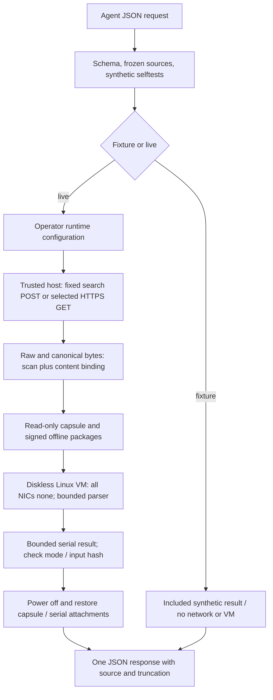

# Architecture

Only search acquisition uses the Tavily credential. Curl receives that secret
via anonymous stdin rather than command-line arguments. Scanner/VM children
receive an explicit credential-free environment. No page cookies or account
headers are supported. Public DNS validation and IPv4 pinning precede transport;
the configured loopback HTTP proxy remains trusted.

The guest verifies input checksums and package signatures, installs packages
without a network repository, runs six synthetic parser tests normally and
under `-O`, then processes one job for search, or 1–5 body jobs in a single boot. CPU/address-space/output bounds and a host
wall-clock deadline are applied. OS no-NIC configuration is distinct from the
Python socket patch; neither is a universal security certification.

Incoming data includes the raw HTTP download tree, not just a later sanitized
copy. The capsule scan is re-bound to its current bytes before guest execution.
The worker renders plain text and preserves preformatted blocks; it does not
run page JavaScript or fetch resources.

## Trusted and mutable state

Trusted: host source/config, scanner, VirtualBox, curl, operator and underlying
OS. Local state and hash manifests can be changed by the same OS user. They
detect mismatch against the configured source version; they do not authenticate
an operator or supply an immutable audit chain.

The agent chooses a search query and a rank. It cannot supply additional JSON
fields for headers, paths or commands. That interface constraint does not
remove capabilities supplied by another tool such as an unrestricted shell.

## Publication adaptations

The public copy retains the runtime layout but removes old fixed-job and cached
receipt entrypoints. Local paths, VM identity, curl hash and proxy move to an
operator file. An optional comparison VM is measured only when configured;
otherwise `old_vm_config_unchanged` is null, not an asserted true result.

Fixtures have a separate schema with `fixture_version` and `synthetic=true`.
They are never stored as `PIPELINE_COMPLETE` receipts. Live reads require a
matching live receipt and query/source binding before the read reservation.

## Bounded batch implementation

`batch_backend.py` reuses acquisition, scanning, source binding and VM cleanup.
Each page is limited to 1 MiB and 4,000 extracted characters. Raw and canonical
input copies share a 12 MiB declaration. `batch_guest.py` launches a fresh worker
per page (5 second wall deadline and the existing resource bounds). Its UTF-8
result frame is limited to 96 KiB within the existing 128 KiB serial bound.
The host checks every page ID, input hash and source URL before success.

The CLI uses an atomic directory lock for live operations. This does not cover
the legacy operator wizard or stop other tools from starting the VM. A process
crash can leave a lock; recovery is an explicit operator action after inspecting
that no operation remains, not automatic lock stealing.
